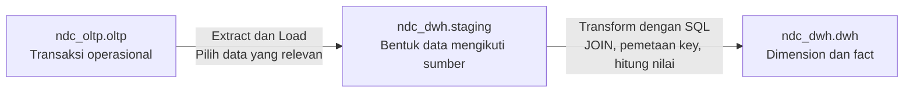
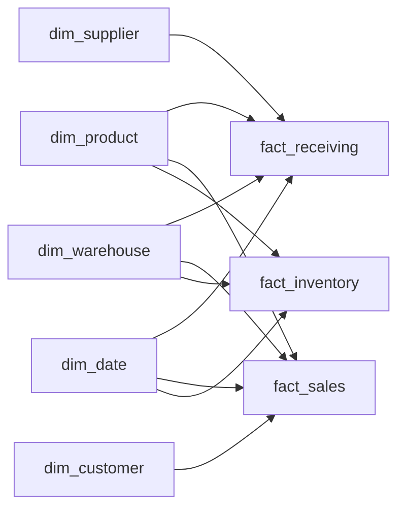

# Desain Tabel OLAP NDC

Database **`ndc_dwh`** terpisah dari database operasional **`ndc_oltp`**.
Di dalamnya ada dua schema: `staging` untuk data sumber terpilih dan `dwh`
untuk **5 dimension dan 3 fact**. Panduan ini menjelaskan struktur dan setup;
untuk pengisian data, lanjutkan ke [panduan ELT](elt.md).

## Alur ELT



Seleksi baris dilakukan saat extract; penggabungan tabel, pembuatan key
dimension, perhitungan nilai, dan konversi tanggal Jakarta dilakukan setelah
data masuk staging. Kedua database tidak bisa di-JOIN langsung dengan nama
`database.schema.table` pada PostgreSQL. Mekanisme pemindahan antar-database
ditangani oleh Python + SQLAlchemy pada [pipeline ELT](elt.md).

## Selective staging

Nama tabel, kolom, tipe data, dan ID mengikuti OLTP. Tidak ada tabel staging
yang digabung atau diubah menjadi bentuk fact. Seleksi awal berfokus pada
**baris transaksi yang mendukung penerimaan posted, penjualan posted, dan movement**.

| Tabel staging | Baris sumber yang akan dipilih |
|---|---|
| `products`, `warehouses`, `suppliers`, `customers` | Seluruh master untuk dimension, termasuk master yang belum bertransaksi |
| `goods_receipts` | GR dengan `posted_at IS NOT NULL` |
| `goods_receipt_items` | Item dari GR terpilih |
| `purchase_order_items` | Item PO yang dirujuk item GR terpilih |
| `purchase_orders` | PO yang dirujuk GR terpilih |
| `goods_issues` | GI dengan `posted_at IS NOT NULL` |
| `goods_issue_items` | Item dari GI terpilih |
| `sales_order_items` | Item SO yang dirujuk item GI terpilih |
| `sales_orders` | SO yang dirujuk GI terpilih |
| `inventory_movements` | Movement yang terkait item GR/GI posted terpilih |

Ada 13 tabel staging karena ketiga fact membutuhkan rantai referensi tersebut.
Selective di sini berarti memilih baris yang relevan, sambil mempertahankan
kolom sumber agar mudah ditelusuri. Contohnya, 12 GI draft pada dummy belum
masuk staging; 96 GI posted dan item terkait akan masuk. Untuk PO yang baru
diterima sebagian, hanya item PO yang sudah memiliki penerimaan posted yang dipilih.

ID staging diisi dari OLTP, tanpa `IDENTITY`. Primary key mencegah ID sumber
ganda. Tidak ada foreign key atau CHECK bisnis di staging, supaya pemuatan
tiap tabel tidak bergantung pada urutan referensi. Kelengkapan referensi dan
kualitas data perlu diperiksa sebelum transform. Kolom nullable tetap mengikuti
sumber, termasuk `posted_at`; syarat posted merupakan aturan seleksi pipeline.
Filter baris diterapkan oleh query extract pada `etl/run_elt.py`, bukan DDL tabel.

## Dimension

| Tabel | Konteks yang disimpan |
|---|---|
| `dim_product` | Produk, kategori, dan satuan |
| `dim_warehouse` | Kode gudang, nama, dan kota |
| `dim_supplier` | Supplier penerimaan barang |
| `dim_customer` | Customer penjualan |
| `dim_date` | Tanggal, tahun, bulan, dan hari |

`product_id` adalah ID sumber dari OLTP, sedangkan `product_key` adalah key
tersendiri di DWH. Hal yang sama berlaku pada warehouse, supplier, dan customer.
Jangan mengasumsikan kedua angka selalu sama. `date_key` menggunakan format
YYYYMMDD, misalnya `20261114`.

## Fact

Grain adalah arti satu baris dalam fact.

| Tabel | Grain | Ukuran |
|---|---|---|
| `fact_receiving` | Satu item GR yang sudah posted | Jumlah diterima, harga beli per unit, nilai penerimaan |
| `fact_sales` | Satu item GI yang sudah posted | Jumlah dikirim, harga jual per unit, nilai penjualan |
| `fact_inventory` | Satu inventory movement | Jenis IN/OUT dan jumlah movement |

Nilai penerimaan = jumlah diterima × harga pada item PO.
Nilai penjualan = jumlah dikirim × harga pada item SO.
Harga berasal dari transaksi, bukan master produk.

ID item GR/GI dan `movement_id` menjadi primary key fact sesuai grain.
ID PO, SO, GR, dan GI disimpan untuk penelusuran ke dokumen asal.

Aturan pengisian data:

- Hanya penerimaan dan pengiriman yang sudah posted yang masuk fact.
- Penerimaan parsial menghasilkan baris terpisah sesuai item GR.
- Penjualan diakui saat GI posted; completion tidak membuat penjualan baru.
- Tanggal analisis berdasarkan waktu posting di Asia/Jakarta.
- `qty_movement` selalu positif; stok fisik dihitung sebagai total IN dikurangi OUT.
- Inventory berbasis movement, bukan snapshot harian, dan belum mencakup reservasi.

## Hubungan Tabel



## Membuat Tabel

1. Pada koneksi database `postgres`, jalankan
   [00_create_database.sql](../sql/dwh/00_create_database.sql) dengan auto-commit aktif.
2. Pindah koneksi ke database **`ndc_dwh`**.
3. Jalankan [01_staging_tables.sql](../sql/dwh/01_staging_tables.sql) untuk schema `staging` dan tabel sumber.
4. Jalankan [02_dwh_tables.sql](../sql/dwh/02_dwh_tables.sql) untuk schema `dwh` dan tabel analitik.

Jalankan setiap file sekali. Tabel masih kosong setelah setup. Tidak ada foreign
key lintas database; hubungan ke OLTP ditelusuri melalui ID sumber yang disimpan.

Jika melalui terminal dari root repo:

```powershell
psql -U postgres -d postgres -v ON_ERROR_STOP=1 -f sql/dwh/00_create_database.sql
psql -U postgres -d ndc_dwh -v ON_ERROR_STOP=1 -f sql/dwh/01_staging_tables.sql
psql -U postgres -d ndc_dwh -v ON_ERROR_STOP=1 -f sql/dwh/02_dwh_tables.sql
```

Jika terjadi error di GUI, jalankan `ROLLBACK;` sebelum mencoba lagi.

Jika schema `dwh` sebelumnya sudah dibuat di `ndc_oltp`, perubahan file ini
tidak memindahkannya otomatis. Setup ini membuat tabel baru di `ndc_dwh`;
schema atau data lama tidak dihapus.
